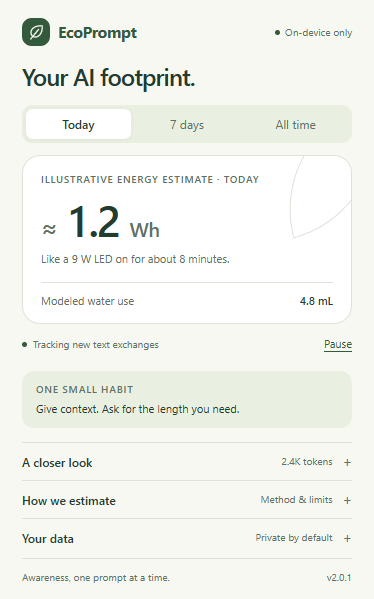

# EcoPrompt

**Your AI footprint, made visible.**

Version **2.0.1** combines the redesigned local tracker with the ChatGPT compatibility fix from 2.0. It recognizes both message layouts, late-assigned role markers, and stable search-unit IDs so remounted messages are not counted again.

EcoPrompt is a small, local-first Chrome extension for more mindful AI use. It tracks new text exchanges on **ChatGPT, Gemini, and Claude**, then turns approximate usage into an illustrative energy estimate and a familiar comparison: time powering a small LED light.

A little awareness, without the guilt or a busy dashboard. Open the popup for a simple overview; expand it when you want to understand the activity or the assumptions behind the numbers.



_Example data from a local test fixture, not measured AI consumption. The popup follows your system's light or dark theme._

## What it does

- **A useful first glance:** Today, the last 7 local calendar days, or all-time usage. One energy estimate, one comparison, and modeled water use.
- **Detail when you want it:** A daily chart with selectable days, platform shares, approximate input/output tokens, and a modeled carbon scenario.
- **Tracking that respects history:** Existing chats are baselined before a send action. New text and streaming replies are counted incrementally; stable message IDs and a pre-send boundary reduce duplicate counts and history inflation.
- **One record across tabs:** A background service worker serializes updates, so simultaneous exchanges do not overwrite each other.
- **Simple controls:** Pause across all supported tabs, download a JSON export with the estimation assumptions, or clear totals and history after an inline confirmation.
- **Private by design:** No accounts, telemetry, external API calls, or runtime dependencies. Chat content stays in memory and is never stored or transmitted by EcoPrompt.

## Install locally

No build, API key, or Node installation is needed to use the extension.

1. Clone or download this repository and extract it if necessary.
2. Open `chrome://extensions` in Chrome.
3. Enable **Developer mode**.
4. Choose **Load unpacked** and select the **`src` directory** inside this repository. That is the directory containing `manifest.json`.
5. Pin EcoPrompt from the browser's Extensions menu.
6. **Refresh any already-open ChatGPT, Gemini, or Claude tabs**, then send a new text message.
7. Open EcoPrompt to see your usage. Earlier chat history is not backfilled.

After changing the extension's code, click **Reload** on its extension card and refresh the AI tabs again. Updating adds a background worker, so refreshing existing tabs is especially important when upgrading from an older version.

The implementation targets Chrome's Manifest V3. Other Chromium browsers may work, but are not separately validated. Firefox and Safari are not currently supported.

## Understanding the estimates

**EcoPrompt is an awareness tool, not an environmental meter.** It cannot see the provider's hardware, electricity use, model configuration, hidden reasoning, or data-center location. None of its displayed environmental quantities is a measurement of your actual consumption.

The current model, `illustrative-v1`, retains the project's original coefficients as **explicit product assumptions**. They are not verified cross-provider averages or calibrated model benchmarks.

| Quantity   | Illustrative assumption                  | Calculation                      |
| ---------- | ---------------------------------------- | -------------------------------- |
| Energy     | 0.0005 Wh per approximate token          | Tokens × 0.0005                  |
| Water      | 0.002 mL per approximate token           | Tokens × 0.002                   |
| Carbon     | Assumed grid intensity of 450 g CO₂e/kWh | Energy in Wh ÷ 1,000 × 450       |
| Comparison | A 9 W LED light                          | Energy in Wh ÷ 9 × 3,600 seconds |

Token counts use the larger of `ceil(words × 1.3)` and `ceil(characters ÷ 4)`, after normalizing whitespace. This is a rough heuristic for visible text, including code and unspaced languages; it is not a provider tokenizer. Input and output use the same environmental coefficient for simplicity, even though their actual computational costs differ. The UI rounds environmental figures to avoid false precision and preserves very small nonzero estimates.

For example, **1,000 approximate tokens** produce **0.5 Wh**, **2 mL** of modeled water, and **0.225 g CO₂e** under these assumptions, equivalent to powering the LED for about **3 minutes**. Those are model outputs, not observed resource use.

Water represents an illustrative cooling-water scenario. Carbon represents an assumed electricity scenario. These are not full lifecycle footprints. The model excludes training, manufacturing, your device, networking, image/audio/video generation, uploaded files, hidden reasoning, tool calls, and previously sent context that the provider may process again.

### Research context

[Epoch AI's analysis of ChatGPT energy use](https://epoch.ai/gradient-updates/how-much-energy-does-chatgpt-use) discusses a typical GPT-4o query and how longer inputs and reasoning can change its energy requirements. [Google's production inference study](https://services.google.com/fh/files/misc/measuring_the_environmental_impact_of_delivering_ai_at_google_scale.pdf) reports a median Gemini Apps text prompt in a specific operating context. These are useful examples of why workload and measurement boundaries matter; **neither source validates EcoPrompt's per-token coefficients**. They should not be generalized to every current model or platform.

The shared coefficients live in [`src/shared.js`](src/shared.js). Changes to the model should include a documented rationale, scope, and model identifier. Stored usage remains approximate token counts, so changing assumptions recalculates the displayed history rather than rewriting usage records.

## Privacy and permissions

EcoPrompt requests `storage` and access to exactly these three sites:

- `https://chatgpt.com/*`
- `https://gemini.google.com/*`
- `https://claude.ai/*`

Content scripts read rendered message text in memory to estimate tokens. Only numeric input/output deltas, a platform hostname, a reset generation, and a random batch identifier are sent to the extension's own background worker. The worker stores totals, per-platform aggregates, local-day history, pause state, activity dates, and a bounded list of recent random batch IDs to avoid duplicate writes on retries.

No prompt text, reply text, chat titles, conversation IDs, full page URLs, or account details are persisted. There is no remote server or browser sync. External links open only when you choose them. The AI services themselves have their own data practices; these statements describe EcoPrompt.

Daily history is limited to the latest **30 local calendar days** on usage updates and in exports; opening an inactive installation does not run a deletion job. All-time and platform totals remain until cleared. Exports omit internal retry IDs and reset generations, and include the model assumptions. Uninstalling the extension removes its local storage.

Existing token totals are preserved when upgrading. Older daily records may lack platform breakdowns; the popup labels this gap rather than inventing an allocation.

## Tracking boundaries and troubleshooting

Detection depends on each website's rendered markup and composer controls. EcoPrompt is designed to reduce overcounting, but it cannot guarantee complete or exact capture.

Regenerated or edited replies may be undercounted when a service reuses message nodes or IDs. Browser fixtures exercise supported patterns; authenticated production UIs still need manual release checks.

| If you notice…                        | Check…                                                                                                                                                                                      |
| ------------------------------------- | ------------------------------------------------------------------------------------------------------------------------------------------------------------------------------------------- |
| No activity appears                   | Refresh the AI tab after installation/update, check that tracking is resumed, and send a new text message. Existing chats are excluded.                                                     |
| Today is empty but All time has usage | Today uses your computer's local calendar day. Activity on earlier days appears in the other views.                                                                                         |
| A send action is missed               | Enter, common send buttons, and composer form submissions are detected. Changed or localized controls, voice input, and unusual regenerate actions may need selector updates.               |
| Counts differ from provider usage     | Counts approximate rendered text. Hidden reasoning, full conversation context, files, and non-text work are outside the model.                                                              |
| Older history affects a total         | Stable IDs and the pre-send boundary help exclude history. A site that replaces the whole transcript without stable IDs can still cause errors; report the platform and reproduction steps. |
| A recently updated tab stops tracking | Reload the extension, then refresh the tab to reconnect its content script. An unsaved in-flight batch may be lost if a tab or browser closes abruptly.                                     |

Pause excludes activity until you resume **and send a new message**. Reset clears all totals, per-platform aggregates, and daily history together; stale batches from before the reset are rejected. A reply already streaming when you pause or reset is excluded until a new exchange starts.

## Development

Use Node.js 22 or later and npm.

```sh
npm ci
npm test -- --runInBand
npm run build
```

The build creates **`ecoprompt.zip`**, with `manifest.json` at its root. It packages only `src/`, works without PowerShell or extra ZIP utilities, and checks manifest file references. You can extract the archive and load that directory as an unpacked extension. A build is not required when loading `src/` directly.

For a real Chromium check with a disposable profile:

```sh
npx playwright install chromium
npm run test:browser
```

The browser check loads the actual unpacked extension and intercepts the three supported domains with local HTML fixtures. It exercises message capture, pause/resume, export download, reset, chart controls, light/dark rendering, and popup dimensions. **It does not call AI services or use your browser profile.** It also refreshes the example screenshots in `docs/`. To use an existing compatible Chromium binary, set `ECOPROMPT_BROWSER` to its executable path.

Unit/integration tests cover concurrent writes, retry deduplication, streaming, nested markup, late-loaded and scrolled history, navigation, pause/reset boundaries, legacy data, calendar boundaries, period selection, exports, and visible errors. Website fixtures protect our detection logic; they do not substitute for checking current authenticated service UIs. Before release, manually verify send-by-keyboard, send-by-button, streaming, chat switching, history scrolling, and pause/resume on each supported service.

```text
src/
  manifest.json       Extension permissions and entry points
  content.js          Send detection and visible-text usage tracking
  background.js       Serialized storage writes and tracking controls
  shared.js           Data normalization, local dates, estimation assumptions
  popup.html          Accessible overview and expandable details
  popup.css           Compact light/dark styles
  popup.js            Period selection, charts, export, and data controls
  icons/              Packaged extension icons
scripts/
  build.js            Dependency-free ZIP packaging
  browser-check.js    Chromium extension smoke test and screenshots
tests/                Jest behavior and integration tests
docs/                 Example popup screenshots
```

## Store and advertising media

The [media kit](media/README.md) contains three Chrome Web Store screenshots, two promotional tiles, and four social ad formats, plus editable source, the original illustration prompt, and a [visual preview](media/preview.jpg). Run `npm run media:build` to refresh the exports from the current interface.

## Contributing

Focused improvements are welcome: keeping platform selectors working, preventing duplicate or missing usage, improving accessibility, and replacing illustrative assumptions with carefully scoped evidence. Include a reproducible case and meaningful regression coverage for tracking changes. Avoid collecting chat content in logs, fixtures, or bug reports; synthetic text is enough.

[MIT licensed](LICENSE).
